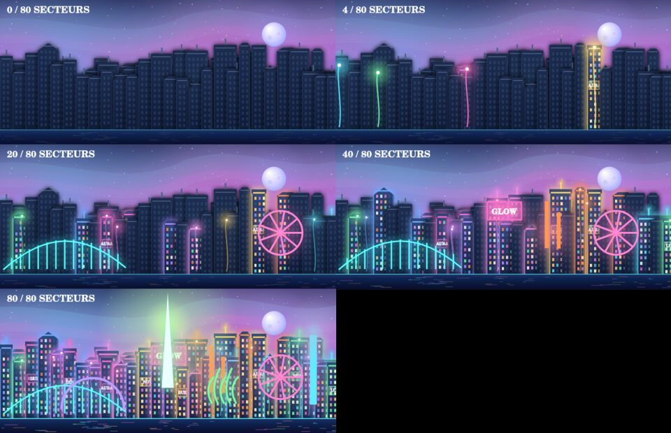

# AFTERGLOW — Neon District

Jeu Android de puzzle à réactions en chaîne — **© 2026 LayAdam corp.**

> Une cité plongée dans le noir. Reliez trois cristaux ou plus, déclenchez des
> réactions spectaculaires et rallumez progressivement les quartiers.

## Version 1.3.0 — une cité vivante, lumineuse et interactive

### Ce qui distingue AFTERGLOW

Le joueur ne débloque pas seulement des niveaux : **chaque victoire réveille
un bâtiment identifiable** dans une même métropole. La couleur des objectifs
réussis devient la couleur de sa façade. Les chaînes projettent des impulsions
dans la ville, qui se transforme durablement et dévoile de nouveaux monuments
à 10, 20, 30… 80 secteurs. Les joueurs peuvent toucher les bâtiments allumés
pour les faire réagir et collecter jusqu'à trois signaux rémunérés par jour
(15 éclats chacun). Les façades encore éteintes montrent ce qu'il reste à
conquérir. La récompense est donc visuelle, exploratoire et économique.



Le panorama est dessiné à l'aide de Canvas 2D original, complété par
[Tween.js](https://github.com/tweenjs/tween.js) pour interpoler les illuminations.
Les 81 emplacements répartissent les 80 secteurs en profondeur, même au début.
Le rendu est autonome, sans appel réseau, avec respect des animations réduites.

La base jouable comprend :

- Commandes tactiles par glissement et système de chemins de couleur.
- Cristaux vectoriels facettés, relief, reflets, halos, chute animée et ondes de choc.
- Ondes spéciales pour les chaînes de 6+ et 9+ cristaux, combos et vibrations.
- Quatre pouvoirs consommables ciblés : Bombe Nova (zone 3 × 3), Laser H,
  Laser V et Prisme Chromatique (suppression de tous les cristaux d'une couleur).
- Grands enchaînements qui déclenchent automatiquement un laser horizontal
  et, dès 9 cristaux, un laser vertical supplémentaire.
- Indice manuel : chemin surligné en or, avec aide automatique après 11 secondes
  sans action. L'aide indique une chaîne réalisable et favorise les objectifs.
- Chronomètre permanent et défi quotidien à durée limitée (2 min 30).
- Missions de niveaux variées : signal classique, triple couleur, réacteur à
  recharger, mission express à coups limités et défi chrono.
- Jauge néon et recharge de pouvoirs, série de victoires et récompense de vitesse.
- Boutique de pouvoirs à éclats, colis gratuit quotidien, trois contrats du jour,
  coffres aux étapes de progression et seconde chance facultative contre éclats.
- 80 niveaux de campagne générés par des graines déterministes.
- Objectifs de deux couleurs, nombre de coups, étoiles et éclats.
- Ville cyberpunk en profondeur : architecture à trois plans, enseignes, lune,
  aurores polychromes, véhicules, reflets, monuments et éclairage progressif.
- Lueur de chaque bâtiment personnalisée par la couleur des objectifs du niveau ;
  panorama interactif dans VILLE et mini-panorama lors d'une victoire.
- Trois signaux quotidiens récoltables sur trois bâtiments distincts, plafonnés
  à 45 éclats par jour pour éviter une économie illimitée.
- 10 effets sonores libres CC0 mixés par Howler.js, musique électro-ambient
  originale, réglages séparés musique/SFX et célébrations canvas-confetti.
- Typographie Inter locale, entièrement hors connexion.
- Défi quotidien déterministe, score et partage natif si disponible.
- Trois ambiances visuelles, avec déblocage uniquement par la monnaie gagnée.
- Sauvegarde automatique après chaque coup et reprise hors connexion.
- Interface tactile portrait, règles, options d'accessibilité et réinitialisation.
- Projet Android natif embarquant l'intégralité du jeu dans une WebView locale.

La **version Android 1.0.0 de développement** a été compilée avec succès par GitHub
Actions le 10 novembre 2026. La V1.3.0 introduit les mécaniques détaillées ci-dessus.
Ce dépôt ne constitue pas à lui seul une publication Google Play. L'installation
sur appareils physiques, la signature de production, la qualité graphique finale
et l'équilibrage doivent être validés avant de parler de version commerciale terminée.

## Jouer en local

```bash
python3 -m http.server 8765 --directory game
```

Ouvrir `http://127.0.0.1:8765/` dans un navigateur récent. Le jeu n'accède à
aucun service distant ; ses fichiers peuvent être mis en cache par la couche
Android pour un usage intégralement hors ligne.

## Obtenir une APK avec GitHub Actions

1. Dans le dépôt, ouvrir l'onglet **Actions**.
2. Choisir **Android APK** puis **Run workflow**.
3. Attendre le statut vert : les sources HTML/CSS/JS sont intégrées à l'APK.
4. Télécharger l'artefact **AFTERGLOW-v1.3-Android-debug-APK**.
5. Extraire `app-debug.apk` et l'installer sur un smartphone Android compatible.

**Attention :** APK de test (clé de débogage), pas APK commercial signé. Une
clé Android debug régénérée sur un nouveau runner CI peut empêcher une mise à
jour par-dessus une ancienne version : une signature stable est indispensable
pour les futures mises à jour sans désinstallation ni perte de sauvegarde.
La **V1.3 Preview** utilise donc temporairement le package Android indépendant
`com.layadam.afterglow.preview13` et apparaît sous le nom `AFTERGLOW V1.3`.
Elle s'installe à côté des V1.0, V1.1 et V1.2, dont les sauvegardes restent intactes,
mais elle **commence une nouvelle progression** : les données Android d'un package
ne sont pas automatiquement transférées à un autre. Ne désinstallez pas les
versions précédentes avant d'avoir validé cette V1.3. La signature Play App
Signing, la génération d'un fichier AAB de release, les tests
Samsung et la fiche Play Store restent à finaliser. L'application cible l'API 36
(Android 16), avec Android 8.0 comme version minimale.

## Organisation

```text
game/                      Jeu et ressources 100 % locaux, dépendances embarquées
android/                   Conteneur Android natif et interface immersive
.github/workflows/android.yml Compilation automatique APK de test
tests/                     Tests moteur et scénario de navigation mobile
docs/                      Dossier produit, stratégie et critères de sortie
THIRD_PARTY.md             Bibliothèques et licences redistribuées
```

## Tests

```bash
node tests/engine.cjs
node tests/skills.cjs
node tests/assets.cjs
# QA graphique facultative avec @napi-rs/canvas dans l'environnement :
node tests/render-city.cjs
```

Les tests du moteur couvrent le parcours de 80 niveaux et au moins 560 coups,
la chute des cristaux, le rendu Canvas avec contexte simulé, la persistance,
les indices, les pouvoirs, les missions, la boutique, le défi quotidien, les
bâtiments et les signaux de la ville. La QA graphique compare également les
pixels colorés entre cinq stades. `tests/smoke.cjs` est un test visuel
Playwright supplémentaire, à exécuter dans un environnement autorisant Chromium
et avec le serveur local actif.

## Confidentialité et propriété

- Aucune publicité, aucun achat réel et aucune bibliothèque de suivi.
- Aucune permission Internet : tout se joue et se sauvegarde localement.
- L'unique permission Android déclarée est la vibration (option désactivable).
- **Code visible publiquement, mais sans licence open source pour le moment.**
  © 2026 LayAdam corp. Tous droits réservés. Le choix d'une licence libre ou
  commerciale doit être fait par le titulaire des droits.

Voir [docs/PRODUCT.md](docs/PRODUCT.md) pour le produit cible et la grille QA,
et [PRIVACY.md](PRIVACY.md) pour la confidentialité. Les bibliothèques et sons
tiers sont documentés dans [THIRD_PARTY.md](THIRD_PARTY.md).
